# Forecasting U.S. Industrial Production with Ridge, Lasso and Regression Trees

An independent Python study of whether penalized regression (Ridge and Lasso) and a regression tree, trained on more than 120 macroeconomic indicators from FRED-MD, can forecast U.S. industrial production growth more accurately than simple benchmarks(AR and mean). Forecasts are evaluated out of sample at horizons of 1, 3, 6 and 12 months.

## Research Question

Do high-dimensional macroeconomic predictors improve forecasts of industrial production growth relative to an autoregressive (AR) model and the historical mean?

Industrial production (INDPRO) measures the real output of U.S. manufacturing, mining and utilities. It is a central indicator of the business cycle, so accurate forecasts are valuable for policy and planning. Many macroeconomic series are related to future output, but they are also strongly correlated with each other. Regularized regression methods are designed for this setting.

In this project, the models are trained on data from 1960 to 2009 and evaluated on data from 2010 to 2026. The test period includes the COVID-19 shock in 2020, so results are reported both with and without that episode.

## Data

The data come from FRED-MD (McCracken and Ng), a monthly database of U.S. macroeconomic indicators maintained by the Federal Reserve Bank of St. Louis. This project uses the September 2026 vintage.

| Item | Description |
|---|---|
| Frequency | Monthly |
| Sample | January 1959 to August 2026 (812 observations) |
| Series | 126 indicators in eight groups |
| Groups | Output, labor market, housing, consumption and orders, money and credit, interest and exchange rates, prices, stock market |
| Target | Percent growth of INDPRO over the next *h* months |

### Preprocessing

- Each series is transformed to a stationary form using the transformation codes assigned by the FRED-MD authors (for example, log differences for activity series and first differences for interest rates).
- Series with more than 10% missing values after transformation are dropped. Four series are removed (ACOGNO, ANDENOx, TWEXAFEGSMTHx and UMCSENTx), which leaves 122.
- Remaining rows with missing values are removed. No values are imputed, so no future information enters the predictors.
- The target is defined as 100 × [log(INDPRO at t+h) − log(INDPRO at t)].

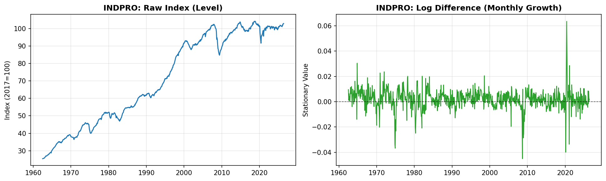

*Figure 1. Left: the raw INDPRO index is trending and non-stationary. Right: its monthly log difference fluctuates around zero and is stationary. The COVID-19 shock in 2020 is clearly visible.*

## Exploratory Analysis

### Distribution of the Target

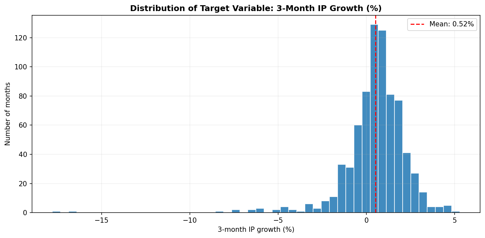

*Figure 2. Distribution of 3-month industrial production growth. The mean is slightly above zero, and a small number of extreme months form long tails.*

The most extreme observations are listed below.

| Rank | Month | 3-month growth | Context |
|---|---|---|---|
| Lowest | January 2020 | −17.8% | COVID-19 shutdown |
| 2nd lowest | February 2020 | −16.5% | COVID-19 shutdown |
| 3rd lowest | October 1974 | −8.4% | 1973–1975 recession |
| Highest | October 1964 | +5.3% | Expansion |
| 2nd highest | June 2020 | +4.7% | Post-lockdown rebound |

### Single Predictors

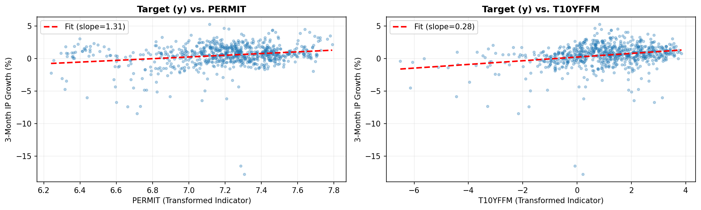

*Figure 3. Future industrial production growth plotted against housing permits (PERMIT) and the term spread (T10YFFM). Both show a positive slope, but the relationship is weak and noisy.*

Individual indicators explain only a small share of the variation in the target. This motivates models that combine many predictors.

### Multicollinearity

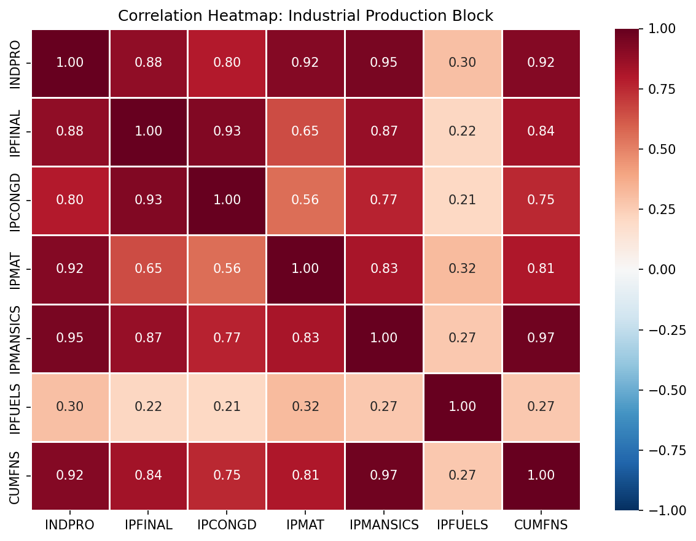

*Figure 4. Correlations within the industrial production block. Several series are almost perfectly correlated, with coefficients of 0.95 or higher.*

Across all predictors, 91 of 7,381 variable pairs have an absolute correlation above 0.8. Ordinary least squares is unstable under this degree of overlap. Ridge and Lasso address the problem directly, so no variables are removed by hand.

## Experimental Design

### Train/Test Split

The sample is split chronologically. Models are estimated on data through December 2009 and evaluated on data from January 2010 onward.

| Period | Observations | Mean 3-month growth (%) | Standard deviation (%) |
|---|---|---|---|
| Training (1960–2009) | 568 | 0.66 | 1.72 |
| Test (2010–2026) | 192 | 0.09 | 2.09 |

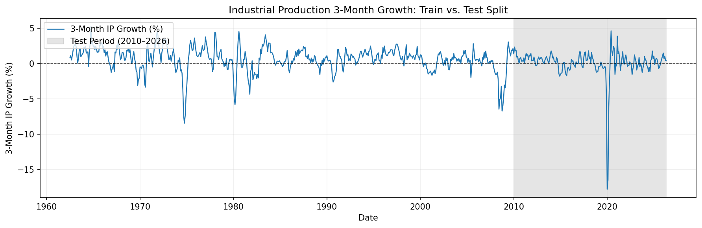

*Figure 5. The shaded region is the test period, which includes the 2020 shock.*

Targets look *h* months ahead. The last *h* − 1 training observations therefore contain information from the test period. These rows are removed to prevent data leakage.

### Hyperparameter Selection

The penalty strength (alpha) of Ridge and Lasso is chosen by five-fold time-series cross-validation on the training data only. Each validation fold uses a gap of *h* periods to avoid overlapping targets. Ridge is searched over 30 values from 10⁻² to 10⁴. Lasso is searched over 30 values from 10⁻⁴ to 10¹. All predictors are standardized before estimation.

### Evaluation Metrics

Accuracy is measured by the root mean squared error (RMSE) on the test set. RMSE grows mechanically with the forecast horizon, so models are also compared by **relative RMSE**:

> Relative RMSE = RMSE of the model / RMSE of the AR(2) benchmark

A value below 1.0 means the model outperforms AR(2). A value above 1.0 means it does not.

To limit the influence of the pandemic, results are also computed excluding all forecast origins whose target window touches March to December 2020.

## Models

### Benchmark 1: Historical Mean

The forecast is the average training-sample growth rate for every month in the test period.

### Benchmark 2: AR(2)

An autoregressive model with two lags. It regresses future *h*-month growth on current and previous-month INDPRO growth. It uses no other indicators.

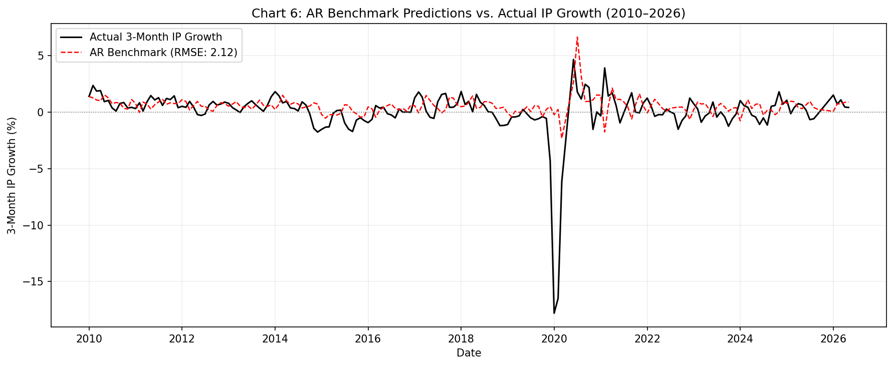

*Figure 6. AR(2) forecasts against actual 3-month growth. The model follows the series in calm periods but cannot anticipate the 2020 collapse, since it relies only on past values.*

| Benchmark | Test RMSE (h = 3) |
|---|---|
| Historical mean | 2.161 |
| AR(2) | 2.116 |

### Model 1: Ridge Regression (L2)

Ridge minimizes the sum of squared residuals plus a penalty on the sum of squared coefficients:

<p align="center">
  
</p>

The penalty shrinks coefficients toward zero but never sets them exactly to zero. All predictors therefore remain in the model.

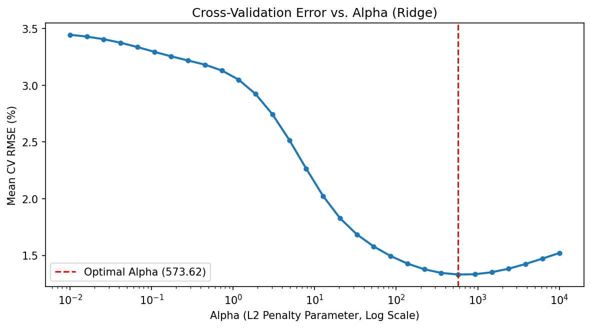

*Figure 7. Cross-validation error against alpha. The curve is U-shaped. The optimum is at alpha ≈ 573.6 (red line). Smaller values leave too much noise in the model, and larger values remove useful signal.*

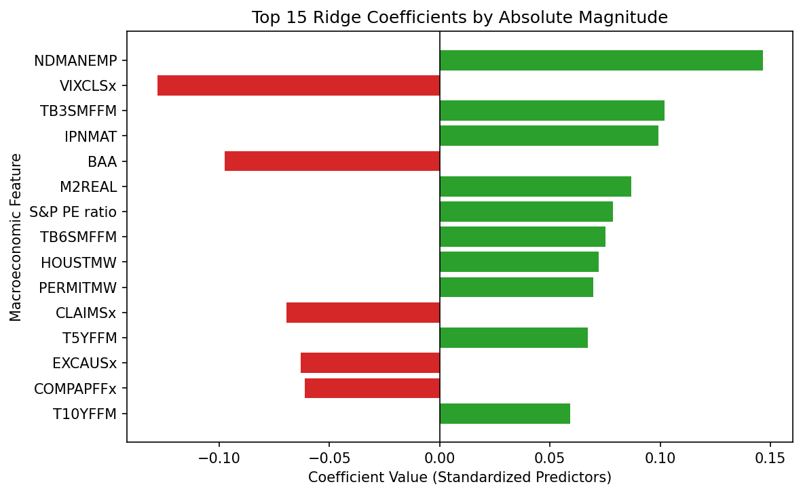

*Figure 8. The 15 largest Ridge coefficients on standardized predictors. Green bars raise the forecast and red bars lower it. Manufacturing employment and favorable yield spreads are positive. Market volatility (VIXCLSx), corporate bond yields (BAA) and initial jobless claims (CLAIMSx) are negative.*

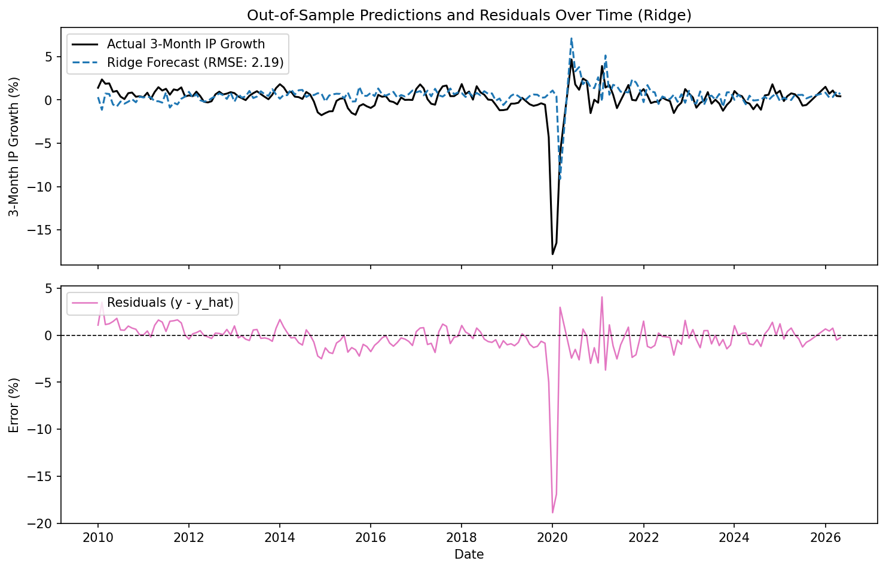

*Figure 9. Top: actual growth and Ridge forecasts. Bottom: forecast errors. Errors are small in expansions and large during the 2020 shock.*

**Ridge test RMSE (h = 3): 2.187**

### Model 2: Lasso Regression (L1)

Lasso minimizes the sum of squared residuals plus a penalty on the sum of absolute coefficients:

<p align="center">
  
</p>

The L1 penalty drives the coefficients of weak predictors to exactly zero. Lasso therefore performs variable selection and returns a sparse model.

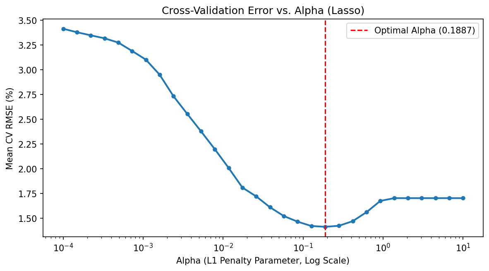

*Figure 10. Cross-validation error against alpha. The optimum is at alpha ≈ 0.189 (red line). At larger values, the penalty removes informative predictors and the error rises.*

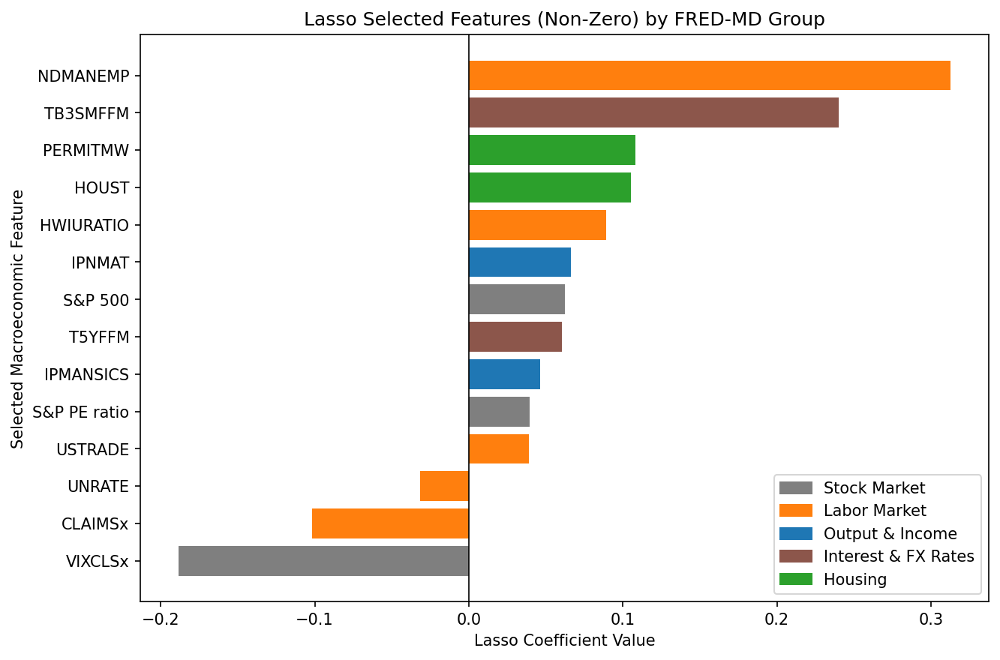

*Figure 11. Predictors with non-zero Lasso coefficients, coloured by FRED-MD group. Lasso discards most of the predictors. The selected set is concentrated in the labor market (for example, NDMANEMP, CLAIMSx, HWIURATIO and UNRATE) and in financial stress indicators (VIXCLSx and TB3SMFFM).*

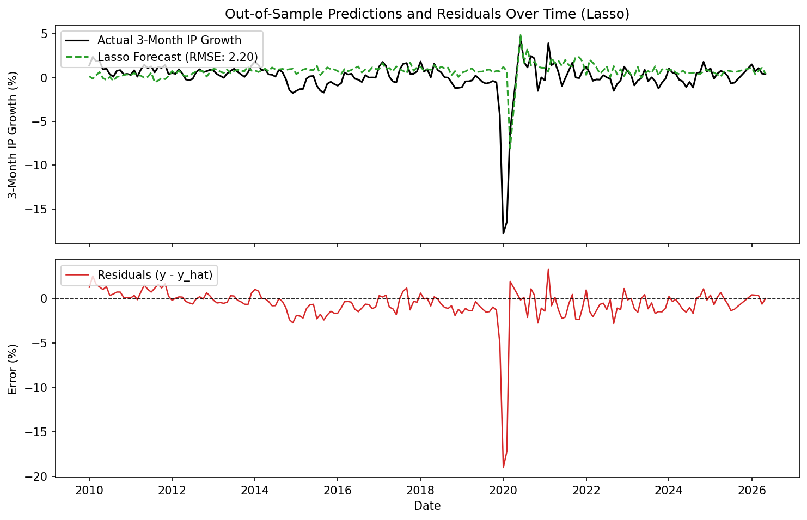

*Figure 12. Top: actual growth and Lasso forecasts. Bottom: forecast errors. The pattern is similar to Ridge.*

**Lasso test RMSE (h = 3): 2.202**

### Model 3: Regression Tree

A regression tree splits the predictor space into regions by choosing, at each step, the variable and threshold that most reduce the sum of squared residuals. The forecast for each region is the mean target value of the training observations in it. The tree depth is limited to three, which allows at most eight leaves.

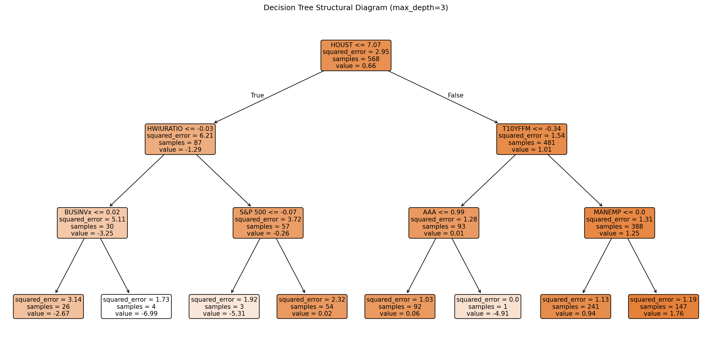

*Figure 13. The fitted tree. The first split is on housing starts (HOUST), which separates severe slowdowns from normal periods. Later splits use labor market variables, term spreads, inventories and the stock market.*

A tree captures non-linear threshold effects. However, it produces a step function, so its forecasts are coarse.

**Tree test RMSE (h = 3): 2.312**

## Results

### Model Comparison at h = 3

| Model | RMSE (full) | Relative to AR(2) | RMSE (excl. COVID) | Relative to AR(2) |
|---|---|---|---|---|
| Historical mean | 2.161 | 1.021 | 0.948 | 0.928 |
| AR(2) | 2.116 | 1.000 | 1.022 | 1.000 |
| Ridge | 2.187 | 1.034 | 1.092 | 1.069 |
| Lasso | 2.202 | 1.040 | 1.125 | 1.101 |
| Regression tree | 2.312 | 1.092 | 1.222 | 1.196 |

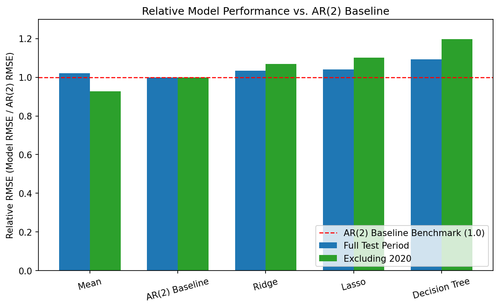

*Figure 14. Relative RMSE with respect to AR(2). The red line marks parity. On the full sample, every high-dimensional model is above the line. Excluding 2020, the historical mean is the best model.*

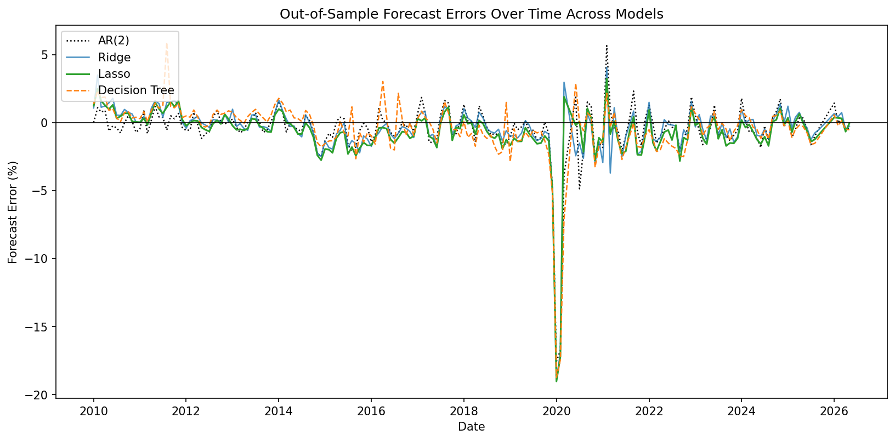

*Figure 15. Out-of-sample forecast errors over time. All models make a large negative error of about 19 percentage points in early 2020. Outside the 2020 window, errors remain within roughly ±3 percentage points.*

### Results Across Forecast Horizons

The full procedure is repeated for h = 1, 3, 6 and 12 months. The tables report RMSE relative to AR(2).

**Full test period**

| Model | h = 1 | h = 3 | h = 6 | h = 12 |
|---|---|---|---|---|
| Historical mean | 1.042 | 1.021 | 1.035 | 1.044 |
| Ridge | 0.890 | 1.034 | 1.127 | 1.093 |
| Lasso | 0.878 | 1.040 | 1.094 | 1.009 |
| Regression tree | 1.135 | 1.092 | 1.246 | 2.798 |

**Excluding the COVID-19 window**

| Model | h = 1 | h = 3 | h = 6 | h = 12 |
|---|---|---|---|---|
| Historical mean | 0.919 | 0.928 | 0.999 | 1.031 |
| Ridge | 0.993 | 1.069 | 1.125 | 1.057 |
| Lasso | 0.970 | 1.101 | 1.162 | 1.076 |
| Regression tree | 1.252 | 1.196 | 1.531 | 4.169 |

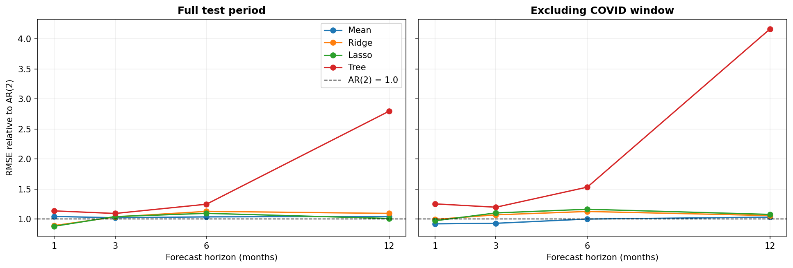

*Figure 16. Relative RMSE by forecast horizon. Left: full test period. Right: excluding the COVID-19 window. Values below the dashed line outperform AR(2).*

### Robustness: Removing the Industrial Production Block

The predictor set contains 13 industrial production series that are closely related to the target. Ridge and Lasso are re-estimated after removing all of them.

| Model | Test RMSE, all predictors | Test RMSE, without IP block |
|---|---|---|
| Ridge | 2.187 | 2.198 |
| Lasso | 2.202 | 2.218 |

Test error increases by less than 0.02 percentage points. The models therefore extract information from other groups, such as labor, housing and money, and do not rely only on series that are similar to the target.

## Conclusions

1. **No model consistently outperforms AR(2).** The clear gains occur only at h = 1 on the full sample, where Lasso and Ridge reduce RMSE by about 11–12%. From h = 3 onward, both are worse than AR(2) on the full sample. The one exception is Lasso at h = 12, which is roughly equal to AR(2) (relative RMSE of 1.009).
2. **The one-month gain depends on 2020.** Excluding the COVID-19 window, Ridge and Lasso fall to relative RMSEs of 0.993 and 0.970, which are close to parity. A plausible explanation is that same-month indicators, such as jobless claims and financial stress, reacted immediately to the shutdown. This explanation has not been tested directly.
3. **The AR(2) benchmark is weak.** Excluding 2020, the historical mean outperforms AR(2) at h = 1 and h = 3. Ridge and Lasso do not beat the mean either. This suggests that industrial production growth is difficult to predict from its own recent history and that the AR(2) relationship estimated on 1962–2009 data does not transfer well to the post-2010 period.
4. **The regression tree performs worst, especially at long horizons.** Its relative RMSE rises from 1.135 at h = 1 to 2.798 at h = 12. Fixed thresholds learned before 2010 can produce extreme forecasts when the later economy lies in a region of the predictor space that the training period associated with recessions.
5. **High-dimensional regularization did not reliably improve forecasts.** Beyond very short horizons, adding more than 120 indicators did not outperform a simple autoregression or the historical mean.

## Limitations

- Results are based on one train/test split. No formal significance test, such as the Diebold–Mariano test, was performed. Differences of a few percent between models should not be over-interpreted.
- Models are estimated once on pre-2010 data and are not updated. Part of the deterioration at longer horizons may reflect parameter instability.
- The data are a revised vintage and not real-time releases.
- During tuning, the Lasso solver reports non-convergence warnings at some very small alpha values in the grid. These values are not selected by cross-validation.

## Repository Structure

```
├── README.md
├── requirements.txt
├── notebooks/
│   └── ridge_lasso_forecasting.ipynb
├── src/
│   ├── config.py      # paths, horizon, split dates, variable groups
│   ├── pull.py        # data download
│   ├── build.py       # transformations, cleaning, target, train/test split
│   ├── tables.py      # summary and comparison tables
│   ├── estimate.py    # benchmarks, Ridge, Lasso, tree, robustness, horizons
│   └── plots.py       # all figures
├── scripts/
│   ├── 01_pull.py
│   ├── 02_build.py
│   ├── 03_tables.py
│   ├── 04_estimate.py
│   └── 05_plots.py
├── data/
│   ├── raw/
│   └── processed/
├── outputs/           # result tables, predictions, fitted models
└── figures/           # all figures
```

## Reproducing the Results

```bash
pip install -r requirements.txt
python scripts/01_pull.py        # download raw data
python scripts/02_build.py       # transform, clean, build target
python scripts/03_tables.py      # descriptive tables
python scripts/04_estimate.py    # estimate all models (slowest step)
python scripts/05_plots.py       # generate all figures
```

The notebook `notebooks/ridge_lasso_forecasting.ipynb` runs the same steps interactively.

## Data Source

McCracken, M. W. and Ng, S. *FRED-MD: A Monthly Database for Macroeconomic Research.* Federal Reserve Bank of St. Louis.
